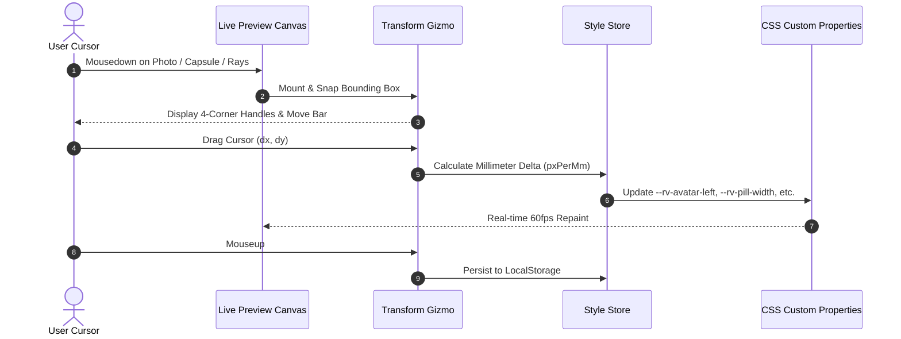

# 📄 ResumeStudio — Modern Professional CV Builder

<p align="center">
  
  
  
  
  
</p>

<p align="center">
  <strong>A high-precision, interactive resume builder featuring a sleek split-column geometric aesthetic, real-time live preview, direct cursor manipulation, per-section typography controls, and pixel-perfect A4 PDF export.</strong>
</p>

<p align="center">
  <a href="https://resume-builder-vamsikrishnasunkara.vercel.app"><strong>🌐 View Live on Vercel »</strong></a>
  &nbsp;•&nbsp;
  <a href="#-architecture--data-flow"><strong>📐 Architecture</strong></a>
  &nbsp;•&nbsp;
  <a href="#-key-features"><strong>✨ Features</strong></a>
  &nbsp;•&nbsp;
  <a href="#-deployment-guide"><strong>🚀 Deploy to Vercel</strong></a>
</p>

---

## 🎨 Design System: Modern Geometric Architecture

ResumeStudio is engineered with a distinctive, high-end editorial aesthetic designed for modern professionals and students:

* **Angled Deep Violet Column (`#21092F`)**: High-contrast geometric polygon with subtle depth and shadow separation.
* **Typographic Hierarchy**: High-impact candidate title set in **Montserrat**, accompanied by a translucent professional badge (`STUDENT` / `ENGINEERING`).
* **Connected Header Geometry**: A soft lavender pill (`#D5BEE8`) contoured with a crisp white border (`3.5px solid #ffffff`) seamlessly connecting with dynamic top-right sunburst accent rays.
* **Profile Photo Containment**: Circular avatar viewport with automatic image clipping that never distorts or overflows.
* **Clean Structured Right Panel**: Generous whitespace dedicated to **About Me**, **Skills**, **Languages**, and **Projects**.

```
┌──────────────────────────────────┬────────────────────────────────────────────────────┐
│  JOHN HANERY                     │         ╭────────────────╮  \ \ \ \ \ \ \ \        │
│  [ FULL STACK DEVELOPER ]        │         │ (Profile Photo)│   \ \ \ \ \ \ \ \       │
│                                  │  ───────╯   (Lavender)   ╰─────────────────────    │
│  EDUCATION:                      │  ABOUT ME:                                         │
│  • B.Tech Computer Science       │  Dedicated software engineer specializing in       │
│    Chanakya University | 2024    │  high-performance web apps & modern systems.       │
│  • Higher Secondary (PCM)        │                                                    │
│    Delhi Public School | 2020    │  SKILLS:                                           │
│                                  │  • Languages: TypeScript, Python, JavaScript       │
│  EXPERIENCE:                     │  • Frontend: React, Next.js, HTML5, CSS3, Tailwind │
│  • Software Engineer Intern      │  • Backend & DB: Node.js, Express, PostgreSQL      │
│    TechNova Labs | 2023-2024     │  • DevOps & Tools: Git, Docker, AWS, REST APIs     │
│  • Frontend Lead Developer       │                                                    │
│    Developer Club | 2022-2023    │  PROJECTS:                                         │
│                                  │  • Drone Telemetry Station: Real-time UI control   │
│  CONTACT:                        │  • ResumeStudio Platform: ATS-optimized builder    │
│  • Tel: +1 (555) 234-5678        │                                                    │
│  • Mail: john.hanery@email.com   │  LANGUAGES:                                        │
│  • Loc: San Francisco, CA, USA   │  • English (Native)   • Spanish (Professional)     │
│  • Web: github.com/johnhanery    │  • German (Conversational)                         │
└──────────────────────────────────┴────────────────────────────────────────────────────┘
```

---

## ✨ Key Features

### 🖱️ Direct Cursor Manipulation
- **Freeform Move**: Select any graphic element (**Profile Photo**, **Lavender Capsule**, **Sunburst Rays**) and reposition it anywhere across the canvas directly with your mouse.
- **Interactive Transform Gizmo**: Hover and drag corner or edge handles to interactively scale, widen, or compress element dimensions in real time.
- **Directional Nudges**: Built-in floating controls (`◀`, `▶`, `▲`, `▼`) for sub-millimeter fine-tuning.
- **Precision Alignment**: Calibrated geometry guarantees seamless, gap-free connection between rays and header capsule.

### 🔠 Individual Section-by-Section Typography
- **Independent Sizing**: Adjust font size for specific elements (**Candidate Name**, **Title**, **Section Headings**, **About Me**, **Skills**, **Education**, **Experience**, **Languages**, **Projects**, or **Contact**) without scaling the entire document.
- **Contextual Floating Pill**: Click any section on the canvas to summon an instant formatting toolbar (`A−`, `A+`, `Bold`, `Italic`).
- **Dynamic CSS Variables**: Over 20 reactive custom properties dynamically updated in the DOM in real time.

### 🌐 Smart Autocomplete APIs
- **Universities Search**: Real-time integration with Hipolabs World Universities API.
- **Worldwide Geocoding**: Real-time location lookup powered by the Photon / OpenStreetMap API.

### 🖨️ Pixel-Perfect ATS & Print Engine
- **Standard A4 Dimensions**: Hard-locked `210mm × 297mm` bounding box with zero print clipping.
- **Page Fill Presets**: Dynamic section gap scaling (`Compact`, `Normal`, `Spacious`, `✨ Fill Page`) to fill the sheet naturally.
- **Browser-Only Privacy**: 100% client-side execution; your resume data never leaves your device.

---

## 📐 Architecture & Data Flow

### System Architecture Diagram

```mermaid
flowchart TD
    subgraph UI ["Client Layer (Browser)"]
        FormPanel["📝 Editor Form Panel\n(Accordion Sections, Inputs)"]
        LiveCanvas["🖼️ Live A4 Preview Canvas\n(210mm × 297mm Exact Paper)"]
        TransformGizmo["🖱️ Interactive Transform Gizmo\n(Corner Resizers & Move Handles)"]
        FloatingPill["🏷️ Contextual Floating Action Pill\n(A-, A+, Nudge ◀ ▶ ▲ ▼)"]
    end

    subgraph StateEngine ["Reactive State & Style Engine"]
        FormState["State Store\n(LocalStorage Sync)"]
        StyleStore["Element Styles Store\n(Individual Section Sizes & Coordinates)"]
        ThemeController["Theme Controller\n(Purple, Indigo, Emerald, Rose, Slate)"]
    end

    subgraph ExternalAPIs ["Real-time External Services"]
        HipoAPI["🎓 Hipolabs Universities API"]
        PhotonAPI["📍 Photon Komoot Geocoder"]
    end

    subgraph ExportEngine ["Production Export Layer"]
        PrintEngine["🖨️ A4 CSS Paged Media Engine"]
        VercelCDN["⚡ Vercel Edge Network Deployment"]
    end

    FormPanel -->|User Input| FormState
    FormState -->|Debounced Save| LiveCanvas
    FormPanel -->|Query| ExternalAPIs
    ExternalAPIs -->|Suggestions| FormPanel

    TransformGizmo -->|Cursor Drag / Resize| StyleStore
    FloatingPill -->|Nudge / Size Step| StyleStore
    ThemeController -->|Palette Swatch| StyleStore

    StyleStore -->|CSS Custom Properties\n--rv-name-size, --rv-pill-width| LiveCanvas
    LiveCanvas -->|Window.print()| PrintEngine
    LiveCanvas --> VercelCDN
```

### Direct Cursor Manipulation Flow



---

## 📂 Project Structure

```
Resume-Builder/
├── index.html         # Main semantic HTML5 application entry point
├── style.css          # Design system, CSS variables & print media queries
├── script.js          # Core reactive controller, drag gizmo & autocompletes
├── vercel.json        # Production Vercel deployment configuration
├── .gitignore         # Clean repository filtering (build & test artefacts)
└── README.md          # Project documentation & architectural blueprints
```

---

## 🎨 Color Palette & Design Tokens

| Token | Hex / Value | Description |
|---|---|---|
| `--rv-sidebar-bg` | `#21092F` | Deep Violet slanted sidebar |
| `--rv-pill-bg` | `#D5BEE8` | Soft Lilac/Lavender horizontal capsule |
| `--rv-sidebar-lilac`| `#CBB4E5` | Sidebar section headings accent |
| `--clr-brand` | `#6B3687` | Primary interactive brand purple |
| `--clr-bg` | `#ECE8F4` | Canvas workspace backdrop |
| `--font-head` | `'Montserrat', sans-serif` | Candidate name & section titles |
| `--font-body` | `'Open Sans', sans-serif` | Descriptions, body copy & subtitles |

---

## 🚀 Deployment Guide (Vercel)

### Option 1: One-Click Vercel Import via GitHub (Recommended)

1. Navigate to [vercel.com/new](https://vercel.com/new).
2. Connect your GitHub account and select **`Resume-Builder`**.
3. Set **Framework Preset** to `Other` (Zero-config static deployment).
4. Click **Deploy**. Vercel will build and serve your resume builder at a global CDN URL in seconds!

### Option 2: Deploy Using the Vercel CLI

```bash
# Install Vercel CLI globally
npm i -g vercel

# Deploy directly from workspace
vercel --prod
```

---

## 🤝 Contributing & License

Contributions, issues, and feature requests are welcome!
Feel free to open an issue or pull request on [GitHub](https://github.com/vamsikrishnasunkara/Resume-Builder).

Distributed under the **MIT License**. See `LICENSE` for more information.

<p align="center">
  Built with ❤️ by <a href="https://github.com/vamsikrishnasunkara">Vamsi Krishna Sunkara</a>
</p>
